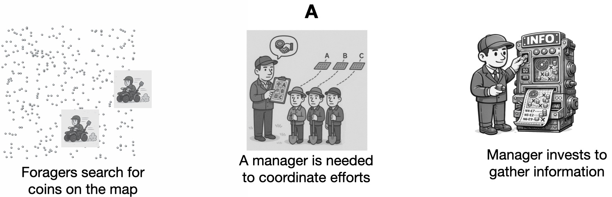
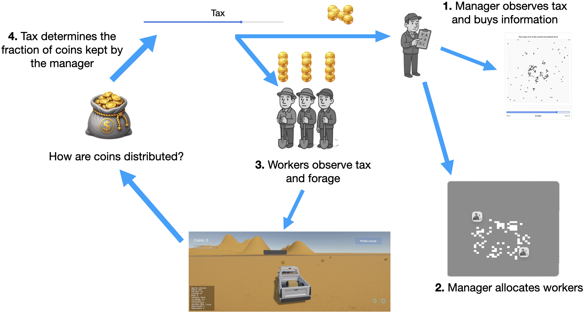
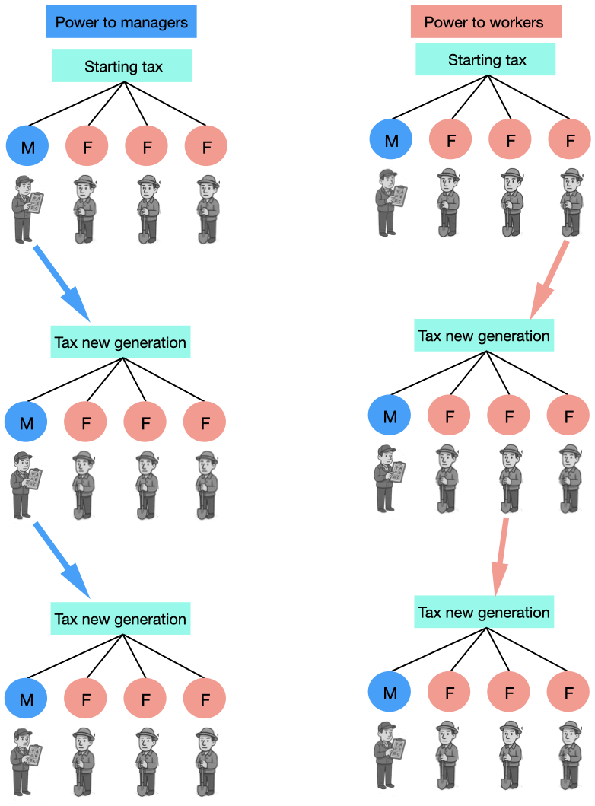
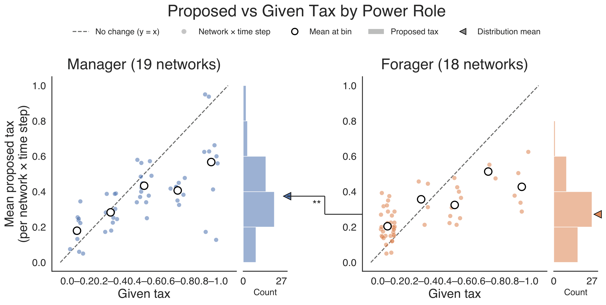

<link rel="stylesheet" href="../assets/css/scrolly.css">

## Research interests

My research investigates how cognitive mechanisms, social interaction, and power relations shape collective intelligence. I study how groups develop complementary roles and how those roles distribute knowledge and control. My experiments and computational models show that people coordinate by selecting psychologically plausible representations that match the history of their interaction and organize complementary behavior. My current work extends this account to the distribution of power across roles. 

My research projects can be summarized in the following topics:

- [Group cognition and cooperation](#group-cognition-and-cooperation)
- [Logic and Semantics](#logic-and-semantics)

## Group cognition and cooperation

In research with Robert Goldstone, I have developed two computational models of how representations organize coordination. *Focal Regions as Attractors* assumes that people consider a limited set of natural partitions of a search space and select among them by comparing each partition with the shared history of their actions. In our *Seeking the Unicorn* experiment, the model outperformed alternative accounts and reproduced the main behavioral patterns of human pairs. 

**[Focal Regions as Attractors](../research/cooperation-and-focal-points/)**

Social interaction, however, is not only shaped by individuals' actions. Indeed, it can also shape their subsequent behavior. This creates a recursive process in which individuals' behavior both generates and responds to the patterns that emerge from their collective actions. Such patterns cannot be fully explained by environmental features or reward structures alone. Coordination patterns also depend on the evolving history of individuals' actions. To explain how humans navigate these open-ended social dynamics, we proposed the Iterative Cognitive Schema Matching (ICSM) model. *Iterative Cognitive Schema Matching* extends this mechanism to groups facing open-ended coordination problems. We evaluated ICSM using the El Farol Bar Problem. Human groups adopted qualitatively different solutions, a pattern first reported at Collective Intelligence. In collaboration with Seth Frey, we wrote a manuscript currently under review. We show that a hybrid of schema matching and two reinforcement-learning mechanisms provided the best account of these group dynamics; complementary formal work identifies a paradox in Arthur's original solution. 

**[Iterative Cognitive Schema Matching](../research/iterative-cognitive-schema-matching/)**

My work on linguistic labor further shows that roles distribute knowledge as well as action: pairs acquired complementary expertise, aligned their use of queries to one another, and performed better when they made greater use of their partner's knowledge.

**[Division of linguistic labor](../research/division-of-linguistic-labor/)**

**Cultural evolution of power**

In [this project](../assets/pdfs/Cultural_evolution_of_power_dynamics_between_workers_and_managers.pdf), we explore the preferences of power roles. Imagine a situation in which your interests are not aligned with those of other people. If you had control over the conditions of the interaction, would you act on self-interest or would you favor a more prosocial configuration?

<section class="scrolly" aria-label="Cultural evolution of power">
  

    

      
      
      
      
    

  

  

    

      
To make these questions concrete, we are developing a large-scale online experiment in which foragers collect resources from the environment.

    

    

      
The size of the harvest is highly dependent on the initial locations of foragers, so we introduce a manager, who invests in information to better coordinate effort and who collects their reward by taxing the foragers' harvest.

      
Now, do foragers prefer a small tax rate? What rate would managers prefer?

    

    

      
We treat these preferences as inductive biases, which we study using the technique of cultural transmission. One generation of manager and foragers use a given tax rate and, at the end of the interaction, either the manager or the foragers (we take their average) propose a new tax rate, which will be the given tax for a new generation. In turn, this generation will propose a new tax and so on.

    

    

      
We found that participants maintained high effort regardless of the tax rate. Although tax proposals reflected role-specific self-interest, managers and workers converged on moderate rather than extreme tax rates.

    

  

</section>

Simulations further showed that Reinforcement Learning or Gibbs Sampling with people can improve collective performance while reducing inequality, motivating future experiments with human–AI institutional design.

**Institutional context of fairness behaviors**

**Division of linguistic labor**

### Logic and Semantics

- A misconception of logic
- Models of language
- DRT and ...
- Leveraging...

[Back to my profile](/profile/)

