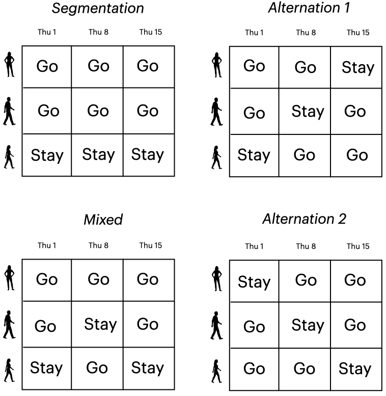
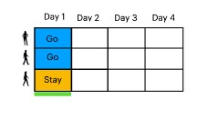
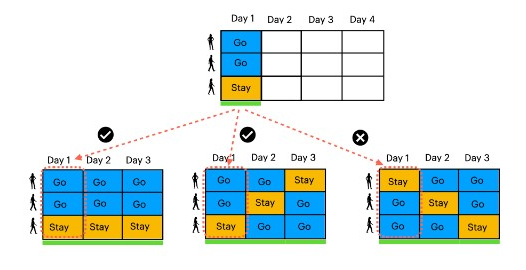
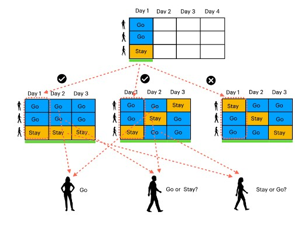
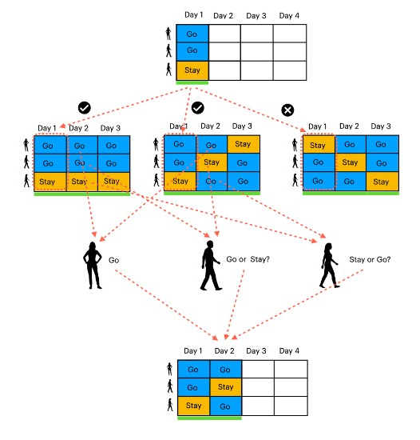

<link rel="stylesheet" href="../assets/css/scrolly.css">

## Research interests

My research investigates how cognitive mechanisms, social interaction, and power relations shape collective intelligence. I study how groups develop complementary roles and how those roles distribute knowledge and control. My experiments and computational models show that people coordinate by selecting psychologically plausible representations that match the history of their interaction and organize complementary behavior. My current work extends this account to the distribution of power across roles. 

My research projects can be summarized in the following topics:

- [Group cognition and cooperation](#group-cognition-and-cooperation)
- [Logic and Semantics](#logic-and-semantics)

### Group cognition and cooperation

In research with Robert Goldstone, I have developed two computational models of how representations organize coordination. *Focal Regions as Attractors* assumes that people consider a limited set of natural partitions of a search space and select among them by comparing each partition with the shared history of their actions. In our *Seeking the Unicorn* experiment, the model outperformed alternative accounts and reproduced the main behavioral patterns of human pairs. *Iterative Cognitive Schema Matching* extends this mechanism to groups facing open-ended coordination problems. In the El Farol Bar Problem, groups converged on qualitatively different but equally successful solutions, a result first reported at Collective Intelligence. In collaboration with Seth Frey, we wrote a manuscript currently under review. We show that a hybrid of schema matching and two reinforcement-learning mechanisms provided the best account of these group dynamics; complementary formal work identifies a paradox in Arthur's original solution. My work on linguistic labor further shows that roles distribute knowledge as well as action: pairs acquired complementary expertise, aligned their use of queries to one another, and performed better when they made greater use of their partner's knowledge.

**[Cooperation and focal points](../research/cooperation-and-focal-points/)**

We observed a similar use of focal regions in a different coordination task: the El Farol Bar Problem. In this paradigm, a town of 100 people has a bar that everyone would like to visit every Thursday. If no more than 60 people attend, everyone enjoys the evening. If attendance exceeds 60, the bar becomes overcrowded, and those who went would have preferred to stay home.

The El Farol Bar Problem captures the tension between individual and collective interests. Each person prefers to attend the bar, but when too many do so, everyone's payoff declines. Moreover, avoiding overcrowding does not guarantee fairness.

<section class="scrolly" aria-label="El Farol coordination">
  

    

      
    

  

  

    

      
Attendance patterns such as the segmented and mixed solutions shown in the left column of the figure achieve efficient use of the bar while producing unequal payoffs across individuals. By contrast, the two alternation patterns in the right column achieve the same level of efficiency while distributing attendance opportunities equally over time.

    

  

</section>

We found that people maintain a small repertoire of intuitive behavioral patterns, then track which focal pattern best reflects the group's recent history and coordinate their actions based on the predictions of this best-fitting schema.

<section class="scrolly" aria-label="El Farol schema selection">
  

    

      
      
      
      
    

  

  

    

      
Starting from a history of attendance decisions,

    

    

      
and a small repertoire of cognitive schemas, individuals evaluate the similarity between the observed history and each candidate schema.

    

    

      
Each schema encodes a complete set of policies, specifying who performs which action and when. In some situations, a single schema is clearly favored; in others, multiple schemas remain plausible.

    

    

      
Individuals then act according to the selected schema, generating a new history and repeating the process.

    

  

</section>

Our proposed computational cognitive model builds directly upon this pattern-prediction intuition. It also includes two lower-level mechanisms, which reward payoff and attendance. This model fits the experimental data better than other models based on reinforcement learning, bounded rationality, and fictitious play.

**Cultural evolution of power**

In [this project](../assets/pdfs/Cultural_evolution_of_power_dynamics_between_workers_and_managers.pdf), we explore the preferences of power roles. Imagine a situation in which your interests are not aligned with those of other people. If you had control over the conditions of the interaction, would you act on self-interest or would you favor a more prosocial configuration?

<section class="scrolly" aria-label="Cultural evolution of power">
  

    

      
      
      
      
    

  

  

    

      
To make these questions concrete, we are developing a large-scale online experiment in which foragers collect resources from the environment.

    

    

      
The size of the harvest is highly dependent on the initial locations of foragers, so we introduce a manager, who invests in information to better coordinate effort and who collects their reward by taxing the foragers' harvest.

      
Now, do foragers prefer a small tax rate? What rate would managers prefer?

    

    

      
We treat these preferences as inductive biases, which we study using the technique of cultural transmission. One generation of manager and foragers use a given tax rate and, at the end of the interaction, either the manager or the foragers (we take their average) propose a new tax rate, which will be the given tax for a new generation. In turn, this generation will propose a new tax and so on.

    

    

      
We found that participants maintained high effort regardless of the tax rate. Although tax proposals reflected role-specific self-interest, managers and workers converged on moderate rather than extreme tax rates.

    

  

</section>

Simulations further showed that Reinforcement Learning or Gibbs Sampling with people can improve collective performance while reducing inequality, motivating future experiments with human–AI institutional design.

**Institutional context of fairness behaviors**

**Division of linguistic labor**

### Logic and Semantics

- A misconception of logic
- Models of language
- DRT and ...
- Leveraging...

[Back to my profile](/profile/)

